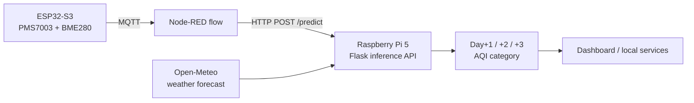
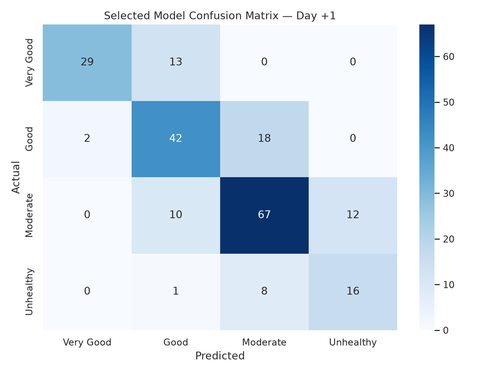
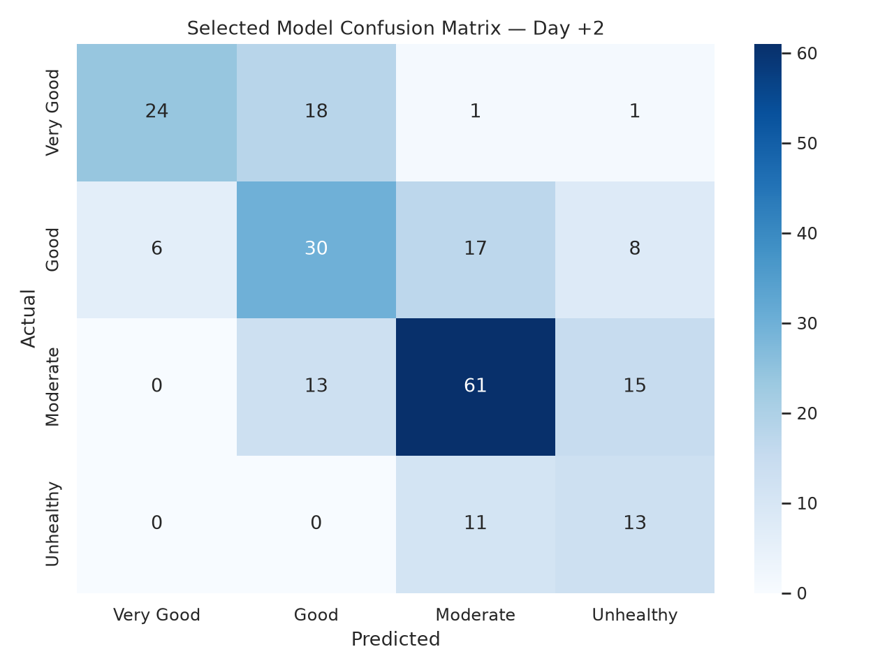
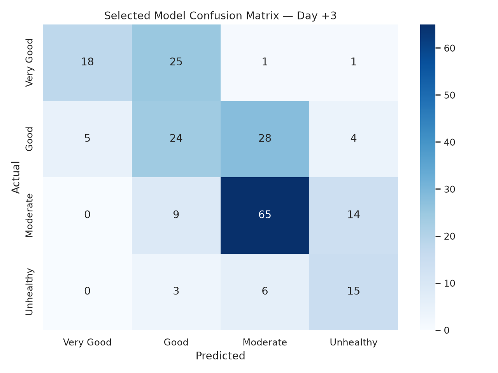

# AeroSense RMUTI: Edge AI Air-Quality Forecasting


An IoT and Edge AI system that classifies and forecasts daily air quality (PM2.5-based AQI category) for the RMUTI campus, 1 to 3 days ahead. Sensing runs on an ESP32 node, and inference runs locally on a Raspberry Pi 5.


**[Watch the project demo](https://drive.google.com/file/d/1ZBaThMWqu1WVWN_qMMPNg4z8c7zzlTCN/view)** · **[Connect on LinkedIn](https://lnkd.in/p/gRp-V3Y4)**

## Abstract

Fine particulate matter (PM2.5) is a major air-quality concern in Thailand, and cloud-only forecasting adds latency and a dependency on connectivity. This project builds an edge system that combines on-site sensor readings (PM2.5, temperature, humidity, pressure) with short-term weather forecasts to predict the next three days of air-quality category on a Raspberry Pi 5. Models were trained on daily records (2023–2026) from a station 2.3 km from campus. Features are built causally and evaluation is strictly chronological, with a 3-row embargo between train and test. On a held-out test set of 218 days, the selected XGBoost models reach macro-F1 of **0.698 (Day+1), 0.562 (Day+2) and 0.533 (Day+3)**. A persistence baseline reaches 0.663, 0.518 and 0.494, so the gain is clear at Day+1 and smaller at Day+2 and Day+3.

> [!NOTE]
> This is a research and deployment prototype, not a packaged production service. Model binaries are not tracked in Git, so a fresh clone must run training before edge inference.

## Key results

Single chronological hold-out (train 2023-01-04 to 2025-11-26, 869 rows; test 2025-11-30 to 2026-08-04, 218 rows). Values are macro-F1.

| Horizon | XGBoost (selected) | LightGBM | Persistence | Training-majority | XGBoost CV | LightGBM CV |
|---|---:|---:|---:|---:|---:|---:|
| Day +1 | **0.698** | 0.694 | 0.663 | 0.111 | 0.607 | 0.577 |
| Day +2 | 0.562 | **0.563** | 0.518 | 0.109 | 0.481 | 0.473 |
| Day +3 | **0.533** | 0.492 | 0.494 | 0.109 | 0.426 | 0.395 |

- Macro-F1 falls by 0.165 from Day+1 to Day+3.
- XGBoost was selected at every horizon because it led cross-validation. On the holdout, LightGBM is marginally higher at Day+2.
- This is one holdout split. It is not a significance test or a production-performance claim.
- An offline demo Random Forest ([`scripts/run_demo.py`](scripts/run_demo.py)) scores 0.626 / 0.572 / 0.547. It is a software demonstration, not the tuned model.

Sources: [`evaluation_report.json`](outputs/evaluation_report.json), [`model_comparison.json`](outputs/model_comparison.json), [`training_run.json`](outputs/training_run.json).

## System architecture



| Layer | Component | Location |
|---|---|---|
| Sensing | ESP32-S3, PMS7003 (PM2.5), BME280 (temp, humidity, pressure) | [`Arduino/`](Arduino/air_quality_sensor.ino) |
| Orchestration | Node-RED flow (credentials removed) | [`node-red/`](node-red/aerosense_edge_flow_sanitized.json) |
| Inference | Flask API (`/predict`, `/health`) | [`RaspberryPi_deployment/`](RaspberryPi_deployment/) |

The hardware layers are optional. The validated workflow is the Python pipeline, the offline demo and the Flask API.

## Dataset

| Item | Value |
|---|---|
| PM2.5 source | OpenAQ v3, sensor 1304112 (station 225602, 2.3 km from campus) |
| Weather source | Open-Meteo archive (14.987°N, 102.118°E, Asia/Bangkok) |
| Period | 2023-01-01 to 2026-08-08 |
| Weather variables | temperature, relative humidity, surface pressure, wind speed, wind direction |
| Model input | 38 ordered features, defined in [`feature_contract.json`](outputs/feature_contract.json) |
| Labels | Thai PCD four-class simplification (below) |

| Class | PM2.5 (µg/m³) |
|---|---|
| Very Good | 0 – 15.0 |
| Good | 15.1 – 25.0 |
| Moderate | 25.1 – 37.5 |
| Unhealthy | > 37.5 |

Data lives in [`data/`](data/): `raw/`, `processed/` and `model_ready/`. Collection details are in [`dataset_metadata.json`](data/raw/dataset_metadata.json).

## Methodology


1. **Collect** ([`00_collect_data.py`](scripts/00_collect_data.py)): daily PM2.5 from OpenAQ and weather from Open-Meteo.
2. **Clean and label** ([`01_data_cleaning.py`](scripts/01_data_cleaning.py)): validates columns, orders dates, forward-fills at most 3 consecutive gaps from past values only, then maps PM2.5 to four classes.
3. **EDA** ([`02_eda.py`](scripts/02_eda.py)): seasonal and correlation analysis.
4. **Features** ([`03_feature_engineering.py`](scripts/03_feature_engineering.py)): the shared causal builder in [`model_contract.py`](src/aerosense/model_contract.py), giving 38 ordered features. Targets are matched by exact calendar date, so a data gap cannot turn a multi-day outcome into a next-day label.
5. **Split** ([`04_train_test_split.py`](scripts/04_train_test_split.py)): 80/20 chronological, with no shuffling. The 3 rows before the holdout are removed to prevent label leakage.
6. **Train** ([`05_train_model.py`](scripts/05_train_model.py)): XGBoost and LightGBM, tuned per horizon with `RandomizedSearchCV` over 5 expanding `TimeSeriesSplit` folds, optimizing macro-F1. Settings are in [`configs/experiment.json`](configs/experiment.json).
7. **Evaluate** ([`06_evaluate.py`](scripts/06_evaluate.py)): accuracy, balanced accuracy, macro-F1, Matthews correlation, log loss, confusion matrices, and persistence and majority baselines.
8. **Forecast** ([`07_forecast_pipeline.py`](scripts/07_forecast_pipeline.py)): produces [`forecast_latest.json`](outputs/forecast_latest.json).

Training records config and data hashes, git revision, package versions and split dates in `outputs/training_run.json`. This improves reproducibility, but it does not guarantee bit-for-bit identity across CPUs or native library builds.

## Results and figures

Current PM2.5 and its short rolling means are the strongest predictors at Day+1. At Day+2 and Day+3, calendar features (`month`, `day_of_year`) rank highest.

| Day +1 | Day +2 | Day +3 |
|---|---|---|
|  |  |  |

Other figures: [`correlation_matrix.png`](outputs/correlation_matrix.png), [`pm25_time_series_seasons.png`](outputs/pm25_time_series_seasons.png), and the weather box plots in [`outputs/`](outputs/). Confusion matrices for every model and baseline are in [`outputs/confusion_matrices/`](outputs/confusion_matrices/).

## Repository structure

```text
├── src/aerosense/           reusable package (feature contract, metrics, experiment utils)
├── scripts/                 00–07 pipeline commands, run_demo.py
├── configs/experiment.json  seeds, splits, CV and search parameters
├── data/                    raw, processed and model-ready datasets
├── outputs/                 reports, provenance, plots
├── tests/                   contract, data-client and demo tests
├── RaspberryPi_deployment/  Flask edge inference service
├── Arduino/                 ESP32 sensor firmware
├── node-red/                sanitized Node-RED edge flow
├── models/                  locally generated artifacts (Git-ignored)
├── pyproject.toml
└── requirements.txt         pinned dependencies
```

## Reproduce

```bash
python3 -m venv .venv && source .venv/bin/activate
python -m pip install -r requirements.txt
python -m pip install -e .

# Offline demo: no API key, network or trained models needed
python scripts/run_demo.py

# Full pipeline. The checked-in data lets you skip 00.
export OPENAQ_API_KEY=your_key   # only for 00_collect_data.py
for s in scripts/0[0-7]_*.py; do python "$s"; done   # 05 creates models/best_day1..3.pkl

python -m pytest -q
```

## Edge deployment

After training has created `models/best_day*.pkl`, run from the repository root:

```bash
python RaspberryPi_deployment/model.py        # serves on 0.0.0.0:5001
```

```bash
curl -X POST http://localhost:5001/predict \
  -H "Content-Type: application/json" \
  -d '{"pm25": 42.3, "temperature": 28.5, "humidity": 65, "pressure": 995,
       "windspeed": 3.2, "winddirection": 90}'
```

The response has a `forecast` object (`day1`, `day2`, `day3`), each with a category, confidence, class probabilities and a feature-confidence note. `GET /health` reports which models loaded. The service needs at least 3 prior daily observations for lag features. If the weather API is unreachable, the latest readings are reused and the failure is reported. See [`RaspberryPi_deployment/README.md`](RaspberryPi_deployment/README.md).

> [!NOTE]
> The service loads the aligned `models/best_day*.pkl` artifacts and validates their feature schema. The older `RaspberryPi_deployment/rf_day*.pkl` files do not match the current 38-feature contract and are not loaded.

## Limitations and future work

- **On-device benchmarks:** inference latency, memory and power on the Raspberry Pi 5 have not been measured yet.
- **Single holdout:** results come from one chronological split on one station and about 3.5 years of data, with no significance testing.
- **Horizon:** Day+2 and Day+3 use persisted PM2.5, and the margin over persistence there is small.
- **Hardware:** wiring, broker settings and end-to-end MQTT behavior are not covered by the Python tests.
- **Packaging:** production-style deployment (service manager, containerization, monitoring) is the next step.

## License

Released under the [MIT License](LICENSE).
