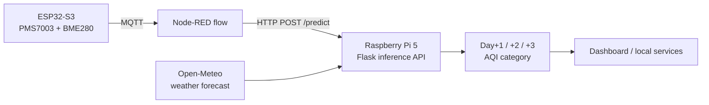

# AeroSense RMUTI: Edge AI Air-Quality Forecasting


An IoT and Edge AI system that classifies and forecasts daily air quality (PM2.5-based AQI category) for the RMUTI campus, 1 to 3 days ahead. Sensing runs on an ESP32 node, and inference runs locally on a Raspberry Pi 5.


## Abstract

Fine particulate matter (PM2.5) is a major air-quality concern in Thailand, and cloud-only forecasting adds latency and a dependency on connectivity. This project builds an edge system that combines on-site sensor readings (PM2.5, temperature, humidity, pressure) with short-term weather forecasts to predict the next three days of air-quality category on a Raspberry Pi 5. Models were trained on 1,113 daily records (2023–2026) from a station 2.3 km from campus, using strictly chronological validation. Macro-F1 on a held-out chronological test set is **0.67 (Day+1), 0.54 (Day+2) and 0.48 (Day+3)**, so the forecast is usable at one day ahead and degrades with the horizon.

## Key results

Chronological hold-out test set, 224 days, 4 classes. The majority-class baseline was not measured (see [Limitations](#limitations-and-future-work)).

| Horizon | Accuracy | Macro-F1 | CV macro-F1 (XGBoost) | CV macro-F1 (LightGBM) |
|---|---|---|---|---|
| Day +1 | 68.3% | 0.673 | 0.571 | 0.569 |
| Day +2 | 54.0% | 0.536 | 0.467 | 0.457 |
| Day +3 | 48.7% | 0.484 | 0.412 | 0.404 |

Accuracy falls by 19.6 percentage points from Day+1 to Day+3. XGBoost was selected for all three horizons. Source: [`outputs/evaluation_report.json`](outputs/evaluation_report.json) and [`outputs/model_comparison.json`](outputs/model_comparison.json).

## System architecture



| Layer | Component | Location |
|---|---|---|
| Sensing | ESP32-S3, PMS7003 (PM2.5), BME280 (temp, humidity, pressure) | [`Arduino/`](Arduino/air_quality_sensor.ino) |
| Orchestration | Node-RED flow (credentials removed) | [`node-red/`](node-red/aerosense_edge_flow_sanitized.json) |
| Inference | Flask API with one model per horizon | [`RaspberryPi_deployment/`](RaspberryPi_deployment/) |

## Dataset

| Item | Value |
|---|---|
| PM2.5 source | OpenAQ v3, sensor 1304112 (station 225602, 2.3 km from campus) |
| Weather source | Open-Meteo archive (14.987°N, 102.118°E, Asia/Bangkok) |
| Period | 2023-01-01 to 2026-08-08 |
| Records | 1,113 daily rows |
| Weather variables | temperature, relative humidity, surface pressure, wind speed, wind direction |
| Labels | Thai PCD four-class simplification (below) |

| Class | PM2.5 (µg/m³) |
|---|---|
| Very Good | 0 – 15.0 |
| Good | 15.1 – 25.0 |
| Moderate | 25.1 – 37.5 |
| Unhealthy | > 37.5 |

Data lives in [`data/`](data/): `raw/`, `processed/` and `model_ready/`. Collection details are in [`dataset_metadata.json`](data/raw/dataset_metadata.json).

## Methodology


1. **Collect** ([`00_collect_data.py`](scripts/00_collect_data.py)): daily PM2.5 from OpenAQ and weather from Open-Meteo.
2. **Clean and label** ([`01_data_cleaning.py`](scripts/01_data_cleaning.py)): handle gaps and outliers, then map PM2.5 to four classes.
3. **EDA** ([`02_eda.py`](scripts/02_eda.py)): seasonal and correlation analysis.
4. **Features** ([`03_feature_engineering.py`](scripts/03_feature_engineering.py)): PM2.5 and weather lags, 3- and 7-day rolling means, trends, and cyclic month and day-of-year terms.
5. **Split** ([`04_train_test_split.py`](scripts/04_train_test_split.py)): chronological, with no shuffling. The target is shifted by 1, 2 or 3 days.
6. **Train** ([`05_train_model.py`](scripts/05_train_model.py)): XGBoost and LightGBM, tuned with `RandomizedSearchCV` and `TimeSeriesSplit(n_splits=5)`, optimizing macro-F1.
7. **Evaluate** ([`06_evaluate.py`](scripts/06_evaluate.py)): accuracy, macro-F1, confusion matrices and feature importances.
8. **Forecast** ([`07_forecast_pipeline.py`](scripts/07_forecast_pipeline.py)): produces [`forecast_latest.json`](outputs/forecast_latest.json).

## Results and figures

Current PM2.5 and its short rolling mean are the strongest predictors at Day+1. Predictive signal from recent PM2.5 weakens at Day+3, where seasonal and weather features matter more.

| Day +1 | Day +2 | Day +3 |
|---|---|---|
|  |  |  |

Other figures: [`correlation_matrix.png`](outputs/correlation_matrix.png), [`pm25_time_series_seasons.png`](outputs/pm25_time_series_seasons.png), and the weather box plots in [`outputs/`](outputs/).

## Repository structure

```text
├── Arduino/                 ESP32 sensor firmware
├── data/                    raw, processed and model-ready datasets
├── node-red/                sanitized Node-RED edge flow
├── outputs/                 metrics, figures, confusion matrices, forecasts
├── RaspberryPi_deployment/  Flask API and deployed models
├── scripts/                 00–07 data and ML pipeline
├── tests/                   data-pipeline tests
└── requirements.txt
```

## Reproduce

```bash
python -m venv .venv && source .venv/bin/activate
pip install -r requirements.txt

export OPENAQ_API_KEY=your_key   # required by 00_collect_data.py
# Run the pipeline in order
for s in scripts/0[0-7]_*.py; do python "$s"; done

pytest tests/
```

## Edge deployment

```bash
cd RaspberryPi_deployment
python model.py        # serves on 0.0.0.0:5001
```

```bash
curl -X POST http://localhost:5001/predict \
  -H "Content-Type: application/json" \
  -d '{"pm25": 42.3, "temperature": 28.5, "humidity": 65, "pressure": 995}'
```

The response contains `predicted_category`, `confidence`, `class_probabilities` and `feature_confidence` for each of `day1`, `day2` and `day3`. `GET /health` reports model status. If the weather API is unreachable, Day+2 and Day+3 fall back to today's weather and are flagged as low confidence. See [`RaspberryPi_deployment/README.md`](RaspberryPi_deployment/README.md).

> [!NOTE]
> The Raspberry Pi service loads RandomForest models (`rf_day*.pkl`, 45 features). The metrics above come from the XGBoost/LightGBM research pipeline in `scripts/`. RandomForest confusion matrices are in `outputs/confusion_matrices/rf_day*_confusion_matrix.png`.

## Limitations and future work

- **On-device benchmarks:** inference latency, memory and power on the Raspberry Pi 5 have not been measured yet.
- **Baselines:** there is no persistence or majority-class baseline in the results.
- **Single station:** one monitoring station and about 3.5 years of data limit generalization.
- **Horizon:** Day+2 and Day+3 use persisted PM2.5, so accuracy drops with the horizon.
- **Model alignment:** the research and deployed models should be unified and re-evaluated together.
- **Packaging:** production-style deployment (service manager, containerization, monitoring) is the next step.

## License

Released under the [MIT License](LICENSE).
